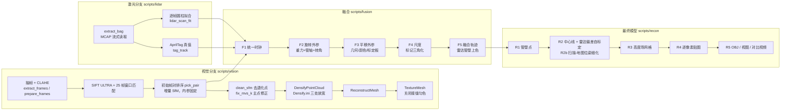

# PipeRecon3D — 管道内窥视频 / 激光雷达融合三维重建

管道机器人的**单目视频** → 运动估计（SfM）→ 稠密点云 → 网格 → 纹理；
有**激光雷达**时，再做时间同步、外参标定和尺度融合，最终得到**公制、管壁厚度约 5 mm 的高度场网格 + 逐像素贴图**模型。

全部代码是 Python（只依赖 numpy / OpenCV / matplotlib / Pillow），重建核心调用 OpenMVG 1.6 + OpenMVS 2.4.0 的 Windows 预编译程序。

| 分支 | 输入 | 输出 | 已验证的数据 |
|---|---|---|---|
| 视觉（运动估计 → 稠密 → 网格 → 纹理） | 任意管道视频（需相机内参） | 带纹理 OBJ、稠密点云、相机轨迹、三维视图、对比视频 | Sheffield Minicam 混凝土管 5 段、15 m 混合管网；新视频测试：实验室混凝土管（新一次行走）、真实地下污水管 Pipe1（换相机） |
| 激光 + 视觉融合（F1–F5）+ 最终模型（R1–R5） | ROS 2 bag：3D 激光雷达 + 彩色相机 + IMU + 轮式编码器 | 公制融合轨迹、外参、高度场网格 + 逐像素贴图 OBJ、局部偏差图、六格对比视频 | InPipe-SLAM 序列 172011（禾赛 128 线 + RealSense） |

**主要结果**（详见 [docs/01_流程复盘.md](docs/01_流程复盘.md) 和 [docs/03_与其他方法对比.md](docs/03_与其他方法对比.md)）

- 视觉：混凝土管 4 段独立检验视频的行程误差 −0.6% … −5.0%（平均 −2.7%），稠密点 87–96% 落在管壁 ±15% 内，整圈覆盖。
- 新视频（没参与调参，[docs/02](docs/02_新视频测试_混凝土管.md)）：实验室混凝土管 448/451 帧、定位误差 0.37%、稠密点 99% 在管壁上；
  真实地下污水管 Pipe 1 前 10 m：701/701 帧、定位误差 0.83%，管顶和侧壁完整，管底水流处有空洞。
- 对比 COLMAP 4.2.1（同一批帧、同一套指标）：默认用法在三段视频上焦距估错 45–200%（行程 +42%、或只注册 13/451 帧、或断成 6 段）；
  用本文标定的内参后，实验室管上稀疏定位与本文相当，污水管上仍断成两段；稠密重建本文 92% 点在管壁上、整圈覆盖，COLMAP 62%、覆盖 64–100%。
- 融合：行程误差 −0.8% / −0.7%（纯视觉按标称管径 −4.9% / −5.7%）；弯头角三种独立方法相差 < 1°。
- 最终模型：横截面内管壁厚度（5–95%）**27.1 mm → 5.1 mm**；留出帧上渲染边缘到真实边缘的距离 **12.0 px → 5.0 px**。

---

## 1. 流程



每一步做什么、为什么这样设、哪些部分被验证过没用而删掉了，见 [docs/01_流程复盘.md](docs/01_流程复盘.md)。

---

## 2. 安装（Windows 10/11 x64）

```bash
git clone <本仓库地址> PipeRecon3D
cd PipeRecon3D
pip install -r requirements.txt
python tools/install_third_party.py
```

- `install_third_party.py` 从官方 GitHub Release 下载 OpenMVG 1.6（45 MB）和 OpenMVS 2.4.0（22 MB），校验 SHA-256 后解压到 `third_party/`（这就是 `scripts/paths.py` 的默认位置，不用再配置）。
- 不要换成 OpenMVG 2.0：它的 Windows 预编译包用了 AVX-512，在没有该指令集的 CPU（如 Ryzen 5000 系列）上直接崩溃；脚本也是按 1.6 的程序名和主点约定写的。
- 不需要 GPU。OpenMVS 稠密重建在 CPU 上跑，500 帧约 25–45 分钟。

**路径配置**：数据和大文件不放在仓库里。复制 `config/paths.example.json` 为 `config/paths.json` 后修改（该文件被 git 忽略），
或用环境变量 `PIPE3D_<键名>` 临时覆盖。检查当前配置：

```bash
python scripts/paths.py
```

| 键 | 含义 |
|---|---|
| `MVG_BIN` / `MVS_BIN` | OpenMVG / OpenMVS 程序目录 |
| `LOGS` | 每一步的完整日志 |
| `INPIPE_EXTRACT` | 从 bag 提取出的数据（`lidar/extract_bag.py` 的输出） |
| `INPIPE_VISION` | 该序列视觉重建的工作目录 |
| `INPIPE_RESULTS` | 该序列的小结果和图（仓库里 `results/inpipe_172011/` 已有一份，包括标定好的外参） |
| `FUSED_BIG` / `RECON_BIG` / `DIAG_BIG` | 融合点云 / 最终模型 / 诊断的大文件 |

---

## 3. 快速上手

### 3.1 一段新视频 → 三维模型 + 对比视频

```bash
python scripts/reconstruct_video.py D:/videos/pipe.mp4 D:/work/pipe --every 5
```

依次运行重建 13 步、`render_views.py`（管外、剖开、侧视、管内视图）和 `video_compare.py`（四格对比视频）。产出：

| 文件 | 内容 |
|---|---|
| `WORK/mvs/scene_textured.obj` + 贴图 | 带纹理网格（MeshLab / Blender 可直接打开） |
| `WORK/mvs/scene_dense.ply` | 稠密点云 |
| `WORK/sfm/recon/sparse_colorized.ply` | 稀疏点 + 相机位置 |
| `WORK/views/model_views.png` | 三维视图整页 |
| `WORK/compare.mp4` | ① 原始帧 ② 同一相机位姿下的模型 ③ 管壁偏差 ④ 侧视剖面上的当前位置 |

**`--every` 怎么选**：让相邻抽帧之间机器人前进约 1 cm，`N ≈ 0.01 m ÷ (速度 m/s ÷ 帧率)`。Sheffield 视频 25 fps、约 4.5 cm/s → 5。

**相机**：默认 `--camera sheffield`，即 Sheffield Minicam 机器人的相机（在本项目里用"管道等径 + 计数器"标定：f = 806 px、k1 = −0.33，只适用于该相机经 `extract_frames.py` 处理后的 768×548 帧）。
**换相机必须先标定**，再用 `--plain --focal --cx --cy --k1`（单位：抽出的帧的像素）：
- 有棋盘格视频（推荐）：`scripts/vision/calibrate_checkerboard.py`，直接输出流程用的相机模型（单焦距 + 一个径向畸变），
  自动检测非方形像素并给出 `--stretch-x`；标定视频和检测视频分辨率不同时用 `--crop/--resize` 换算到检测视频的像素。
  画面里有烧录文字（距离、日期）时用 `--crop X0 Y0 X1 Y1` 裁掉，否则静止的文字会变成"不动的特征点"。真实污水管 Pipe1 的完整示例：

  ```bash
  python scripts/vision/calibrate_checkerboard.py "Calibration Checkerboard.mp4" camera.json --pattern 9 6 --crop 190 0 1090 720 --resize 720 576
  python scripts/reconstruct_video.py Pipe1.avi D:/work/pipe1 --every 1 --last 700 --plain --crop 0 0 720 490 --stretch-x 1.0159 --focal 489.7 --cx 332.4 --cy 264.5 --k1 -0.2477
  ```

  `--plain --crop --stretch-x` 也会传给对比视频，保证左边的原始帧和模型对齐（不传时 720×576 的视频会被当成 Sheffield 视频裁剪）。
  长的真实污水管会轻微弯曲，一根直圆柱拟合不了：三维视图和对比视频加 `--straighten`（逐段校正中心和尺度），管径不是 300 mm 时设 `PIPE3D_PIPE_DIAMETER_M`。
  只重画视图和视频（不重建）时加 `--skip-recon`：

  ```bash
  PIPE3D_PIPE_DIAMETER_M=0.435 python scripts/reconstruct_video.py Pipe1.avi D:/work/pipe1 --skip-recon --plain --crop 0 0 720 490 --stretch-x 1.0159 --straighten
  ```
- 没有棋盘格、但有一段等径直管和行程真值：按 `docs/history/sheffield/标定与检验.md` 的方法，用 `vision/calibrate.py` 先扫 k1（让管径沿程不变），再调焦距（让行程等于真值）。
- **不要让 SfM 自己估焦距**：相机沿管轴前进时焦距几乎不可观，COLMAP 默认自标定在混凝土管上把模型拉长了 42%（docs/03）。

**评估（有画面里程计数器时）**：

```bash
python scripts/vision/evaluate.py counter-templates VIDEO WORK/counter_glyphs.png   # 看图给每个字形簇标数字
python scripts/vision/evaluate.py counter VIDEO WORK/counter.csv "0=0,1=0,2=1,..."
python scripts/vision/evaluate.py sparse CONVERTER WORK/sfm/recon/sfm_data.bin WORK/frames.csv WORK/counter.csv WORK/sparse_eval
python scripts/vision/evaluate.py dense  CONVERTER WORK/sfm/recon/sfm_data.bin WORK/frames.csv WORK/counter.csv WORK/mvs/scene_dense.ply WORK/dense_eval
```

`CONVERTER` 是 `openMVG_main_ConvertSfM_DataFormat.exe` 的完整路径（`python scripts/paths.py` 会打印）。
画面太亮导致字形簇很多时，只给大簇标数字并加 `--nearest`。管径不是 300 mm 时设环境变量 `PIPE3D_PIPE_DIAMETER_M`（如 0.225）。

**有逐帧真值距离、但不知道管径时**（例如数据集给了里程表）：把真值写成 `WORK/counter.csv`（`source_frame,counter_m`），然后

```bash
python scripts/vision/eval_gt_scale.py WORK WORK/gt_eval
```

用一个全局尺度对齐真值后报告定位误差（MAE、最大误差、占行程的百分比）、分段尺度漂移和模型推出的管径——与文献评估 ORB-SLAM3 的方式一致。

**分段重建**：SfM 在颠簸、无纹理处会断开（日志里注册率低于 90%）。对未覆盖的帧段单独重建，再按管轴坐标拼接：

```bash
python scripts/vision/run_pipeline.py WORK --part b --views 250 776 --loose 7 8 9 10 11 12 13
python scripts/vision/merge_parts.py CONVERTER WORK WORK/merged WORK/merged/merged.ply a b
python scripts/vision/render_views.py CONVERTER WORK WORK/views --parts a b
python scripts/vision/video_compare.py WORK WORK/compare.mp4 --video VIDEO --parts a b
```

### 3.2 激光 + 视觉融合（InPipe-SLAM）

```bash
python scripts/lidar/download_parallel.py <Zenodo 文件 URL> <字节数> D:/fusion/raw/seq.zip <MD5>
python scripts/run_inpipe.py --list                     # 列出全部阶段
python scripts/run_inpipe.py --zip D:/fusion/raw/seq.zip # 从提取到最终模型全部跑完
python scripts/run_inpipe.py --from r1 --to r5_video     # 只重跑最终模型
```

阶段：`extract → lidar → lidar_short → tags → vision → vision_eval → f1 → legs → f2 → f3 → f3_icp → f4 → f5 → r1 → r2 → r3 → r4 → r5 → r5_video`。
最终模型在 `RECON_BIG/model/`（`pipe_textured.obj` 贴图版、`pipe_deviation.obj` 局部偏差着色版），对比视频 `results/inpipe_172011/viz/compare_new.mp4`。

**外参是标定结果，不是某一阶段的输出**：`results/inpipe_172011/fusion/extrinsic_translation_final.json` 由 F3 的三种方法人工综合得出（文件里记录了取舍依据）。
换机器人时：先跑到 `f3`，看 `extrinsic_translation.json`（几何）、`extrinsic_translation_photo.json`（颜色，横向可用）、`f3g_board.json`（标定板，轴向）后，按同样格式写这个文件，再跑 `f4` 之后的阶段。

---

## 4. 目录结构

```
PipeRecon3D/
├─ README.md / LICENSE（MIT）
├─ requirements.txt / .gitignore
├─ config/paths.example.json      路径模板（复制为 paths.json）
├─ tools/install_third_party.py   下载 OpenMVG 1.6 / OpenMVS 2.4.0
├─ scripts/
│  ├─ paths.py                    所有路径的唯一来源
│  ├─ reconstruct_video.py        视频一键：重建 + 视图 + 对比视频
│  ├─ run_inpipe.py               激光+视觉融合一键（分阶段）
│  ├─ pipe_geometry.py, ply_io.py 圆柱/圆/椭圆拟合，PLY 读取（纯 numpy）
│  ├─ vision/   run_pipeline.py（视频）run_vision.py（bag 帧）及其辅助脚本、Densify.ini、
│  │            calibrate.py（内参标定扫描）evaluate.py（计数器 OCR + 稀疏/稠密评估）
│  │            calibrate_checkerboard.py（棋盘格标定）eval_gt_scale.py（逐帧真值评估）
│  │            compare_models.py merge_parts.py render_views.py video_compare.py draw_flowchart.py
│  ├─ lidar/    extract_bag.py download_parallel.py lidar_scan_fit.py lidar_map.py tag_track.py
│  ├─ fusion/   timebase.py vision_model.py f1…f5（f3_register.py = ICP 基线，用于对比）
│  ├─ recon/    recon_common.py r1…r5b（最终模型）
│  ├─ viz/      make_video.py（原始数据视频）compare_views.py（视觉网格 vs 雷达管壁）
│  ├─ analysis/ 诊断脚本（管壁模糊分解、扇区半径、两模态错位、在视频本身上核实焦距 focal_check_*），不在主流程里
│  └─ baselines/ run_colmap.py colmap_eval.py（COLMAP 对比，同一套评估指标）
├─ results/
│  ├─ inpipe_172011/              融合各阶段的小结果和图（含外参、时钟、尺度等标定文件）
│  ├─ sheffield/                  视觉分支在 Sheffield 视频上的评估 json/csv/图
│  ├─ new_video_concrete_lab/     新视频测试：实验室混凝土管（新一次行走）
│  ├─ new_video_sewer_pipe1/      新视频测试：真实地下污水管 Pipe1（换相机，棋盘格标定）
│  └─ baselines_colmap/           COLMAP 对比的评估 json/图和耗时
└─ docs/
   ├─ 01_流程复盘.md               每一步的作用、证据、删掉了什么
   ├─ 02_新视频测试_混凝土管.md
   ├─ 03_与其他方法对比.md
   └─ history/                    研究过程中的原始记录（中文，按时间）
```

---

## 5. 注意事项（务必读）

1. **尺度**：纯视觉没有尺度。视觉分支默认用"管径 = 300 mm"定尺度，换管径设环境变量 `PIPE3D_PIPE_DIAMETER_M`（`evaluate.py`、`render_views.py`、`video_compare.py` 都读它）；
   有逐帧真值距离时用 `eval_gt_scale.py`，它不需要管径。融合分支的尺度来自 AprilTag（100 mm）和编码器。
2. **内参只对标定过的相机有效**，而且必须是**拍这段视频的那台相机**。f、k1 错了会出现"锥形管"（管径首尾比 0.55）和 10–20% 的行程误差，重投影误差却看不出来；
   沿管轴前进的视频只能看出"焦距 × 管径"，所以焦距错会把管子画粗或画细，SfM 自己看不出来。怀疑标定不属于这台相机时，用
   `scripts/analysis/focal_check_rotation.py`（视频里有云台转动、机器人不动的一段时，直接测 f）和 `focal_check_rings.py`（用真值里程测 f × 管半径）在视频本身上核实；
   真实污水管 Pipe 1 的完整例子见 docs/03 第 4 节（论文写约 600 mm，核实结果 420–465 mm，标定焦距是对的）。
   广角镜头的单参数畸变模型够不到画面四角（Pipe 1 约 11%），模型图里那部分留空白。
3. **无纹理的管壁做不了**：特征法 SfM 依赖管壁纹理。光滑、深色、照明不足的管壁（例如低照度下的黑色塑料管）每对帧只有几十个以下的可验证匹配，SfM 无法续接，时域平均和去噪也救不回来；这类管道需要更强照明、结构光/激光，或换学习型匹配。混凝土管、陶土管的纹理通常足够。
4. **OpenMVG 1.6 → OpenMVS 2.4.0 主点差半幅图像**，`fix_mvs_k.py` 必须在 openMVG2openMVS 之后运行（流程里已自动做）。
5. **TextureMesh 的接缝匀色在这类视频上会把 57–98% 的面变黑**，流程里已关掉；代价是相邻面片之间能看到明暗差。
6. **DensifyPointCloud 崩溃（0xC0000409）** 多半是稀疏模型里有落在相机背后的点，`clean_sfm.py` 已处理；仍崩溃时检查 `LOGS/<工作目录>/step11_*.log`。
7. **融合的雷达绝对管径未被独立核实**：雷达在 0.2 m 内有非线性测距误差，第一节管雷达和视觉相差约 10%（docs/history/inpipe_172011/02、03）。最终模型保证的是管壁"薄"和各帧一致，不是绝对半径。
8. 中文路径：`cv2.imwrite` 不能写非 ASCII 路径，脚本里统一用 `cv2.imencode(...).tofile(...)`；新增代码请照做。
9. 大文件（视频、点云、网格、npz）不进 git（见 `.gitignore`）。要分享结果，放 GitHub Releases 或网盘。
10. **管底的水和沉积物重建不出来**：水面在动、会反光，相邻帧之间没有一致的深度。真实污水管 Pipe 1 的下半周只覆盖 58%（上半周 89%），并有伸向管内的飞片。
11. **一次只跑一个重任务**：在 16 GB 内存、6 核的机器上，同时跑 OpenMVS 稠密 + OpenMVG SfM + COLMAP GPU 稠密曾导致蓝屏重启。
    稠密重建被中断后，删掉 `WORK/mvs/depth*.dmap` 从步骤 11 重跑（几何一致性迭代要读相邻图像的深度图，不要接着半途的文件跑）；SfM 结果完整写出的话可以保留。
12. 后台运行时以日志为准：`reconstruct_video.py` 某一步失败会打印 `failed with exit code N`，但如果它后面还接了 `grep`/`tail` 等命令，外层的退出码可能仍是 0。

---

## 6. 下一步优化的入口

| 想改进的地方 | 改哪里 | 现状 / 线索 |
|---|---|---|
| 无纹理、暗的管道 | `vision/extract_frames.py`（预处理）、`run_pipeline.py` 步骤 4–5 | 时域平均 + 去噪无效；可试学习型特征（SuperPoint/LightGlue）或更强照明 |
| SfM 引擎 | `run_pipeline.py` 步骤 7–9，或 `baselines/run_colmap.py --fixed` | 同样的标定内参下，实验室管上 COLMAP 稀疏定位与 OpenMVG 相当，真实污水管上断成两段（docs/03） |
| 管底水流 / 沉积 | `run_pipeline.py` 步骤 11：每帧一张 `.mask.png` 遮住水流带，`DensifyPointCloud --mask-path DIR --ignore-mask-label N`（OpenMVS 2.4.0 已支持）；网格后剪掉过长三角形 | Pipe 1 下半周只覆盖 58%，有飞片 |
| 真实污水管的绝对管径 | `analysis/focal_check_rotation.py` 的 f 有 ±10%（云台转轴不在光心）；有实测管径或一块已知尺寸的标记就能把 Pipe 1 的 420–465 mm 收窄 | 已排除"标定焦距不对"（docs/03 第 4 节） |
| 视频局部尺度起伏（同一管道五次重建最多差 9%） | `evaluate.py` 的逐段按管径修正；或在 SfM 里加"等径"约束 | 逐段修正后降到 ≤ 3.4% |
| SfM 断开 | `pick_pair.py --loose`、`--part`、`merge_parts.py` | 15 m 管网断成 4 段，靠计数器拼接 |
| 纹理接缝明暗差 | `run_pipeline.py` 步骤 13，或改用 `recon/r4_texture.py` 的平场 + 曝光补偿思路 | R4 已在融合模型上实现 |
| 雷达剩余 ±1–2 mm 斜条纹 | `recon/r2_centerline_calib.py`：按（线号, 方位角）或入射角建模 | docs/history/inpipe_172011/05 |
| 管口端面 / 台阶 | `recon/r3_heightfield.py`：高度场表示不了垂直于管轴的面，可改 TSDF | 同上 |
| 超声 / 声呐 | 作为同一 (u, θ, r) 管道坐标系上的一层（`recon_common.Centerline`） | 尚未接入 |

---

## 7. 数据、引用与许可

- Sheffield 管道视频：University of Sheffield ORDA，Karnezis 等，CC BY 4.0（混凝土管 10.15131/shef.data.28046066、混合管网 28047074）。
- 真实污水管视频：University of Sheffield ORDA 10.15131/shef.data.21198070，CC BY-NC-SA 4.0（仅非商业用途）；Edwards 等，Frontiers in Robotics and AI，2023，10.3389/frobt.2023.1150508。
- InPipe-SLAM：Zenodo 18615583，CC BY 4.0。
- OpenMVG（MPL-2.0）、OpenMVS（AGPL-3.0）、COLMAP（BSD）为第三方程序，本仓库只调用其预编译程序，不包含它们的代码。
- **本仓库的代码和文档采用 MIT 许可证**（见 [LICENSE](LICENSE)）。
- 第三方程序不在仓库里，各自遵循自己的许可证：OpenMVG 1.6 和 OpenMVS 2.4.0 由 `tools/install_third_party.py` 从官方发布页下载；
  COLMAP 只用于对比实验，需要时自己从 https://github.com/colmap/colmap/releases 下载（本项目用的是 4.2.1 CUDA 版）。
  如果把 OpenMVS 的程序和本仓库打包在一起分发，还需遵守 AGPL-3.0。
- `results/` 里由数据集画面生成的图（预览拼图 `contact_sheet.jpg`、对比视频截帧 `compare_*.jpg`、`model_views.jpg`、`focal_check/` 里的画面等）
  沿用对应数据集的许可，不属于 MIT 授权范围：Sheffield 管道视频与 InPipe-SLAM 为 CC BY 4.0，真实污水管 Pipe 1 为 CC BY-NC-SA 4.0（仅非商业用途）。
